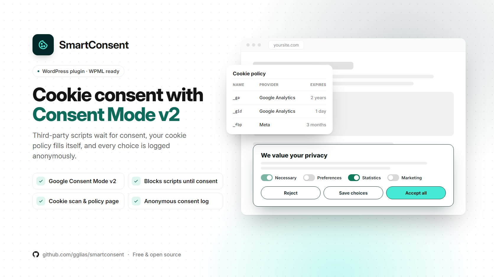

# SmartConsent

A cookie consent banner for WordPress with Google Consent Mode v2. Third-party scripts wait for the visitor's consent, the cookie policy table fills itself, and every choice is logged anonymously. WPML ready.

> [!NOTE]
> **Built for the Smartup website.** This plugin was made for Smartup's own website ([smartupweb.com](https://smartupweb.com)). Some settings may show the Smartup name by default, and in a few places it may not be changeable from the admin.
>
> **Need a white-label version?** Send me a message or email me at **[gregolia@gmail.com](mailto:gregolia@gmail.com)** and tell me what you need.

> [!WARNING]
> This plugin helps with cookie consent. It is not legal advice. Check your own setup against the rules that apply to your site.

## Features

- **Four categories.** Necessary (always on), Preferences, Statistics and Marketing. Visitors can Accept all, Reject, or choose per category. Accept and Reject get equal weight by default, so neither choice is pushed. The banner can sit left, right or center.
- **Google Consent Mode v2.** Everything starts as "denied" and is updated after the visitor chooses. Google, Meta Pixel, Microsoft Clarity and Hotjar tags load only after consent, from the IDs you enter.
- **Auto-blocker.** Known tracking tags added by other plugins or your theme are held back until consent. YouTube, Vimeo and Google Maps embeds show an "Accept and show" placeholder.
- **Respects Global Privacy Control.** Consent lasts the number of months you set, and cookies are cleaned up when consent is withdrawn.
- **Anonymous consent log.** No IP address or user agent is stored, only a random consent ID. The admin gets stats, and you can ask everyone again with one click.
- **Cookie policy tools.**
  - A site scan, backed by a built-in library of known services and their cookies.
  - A one-click cookie policy page in English and Greek.
  - Shortcodes for the cookie table and for a "Cookies" link.
- **WPML.** Greek translation included.

## Shortcodes

| Shortcode | What it does |
| :-- | :-- |
| `[smartconsent label="Cookies"]` | A link that reopens the consent banner, e.g. in your footer |
| `[smartconsent_cookies]` | The cookie table for your cookie policy page |

## Requirements

- WordPress 6.1 or newer
- PHP 7.4 or newer

## Installation

1. Download the latest `smartconsent.zip` from [Releases](../../releases).
2. In WordPress go to **Plugins → Add New → Upload Plugin**, choose the zip and click **Install Now**.
3. Activate **SmartConsent**, add your tracking IDs, run a scan and create your cookie policy page.

Or clone this repository into `wp-content/plugins/smartconsent`.

> [!IMPORTANT]
> The plugin doesn't update itself from WordPress.org. To update, download the new release and upload it again.

## License

[GPL-2.0-or-later](LICENSE).

Made by [Greg Glias](https://gglias.github.io) at [Smartup](https://smartupweb.com).
